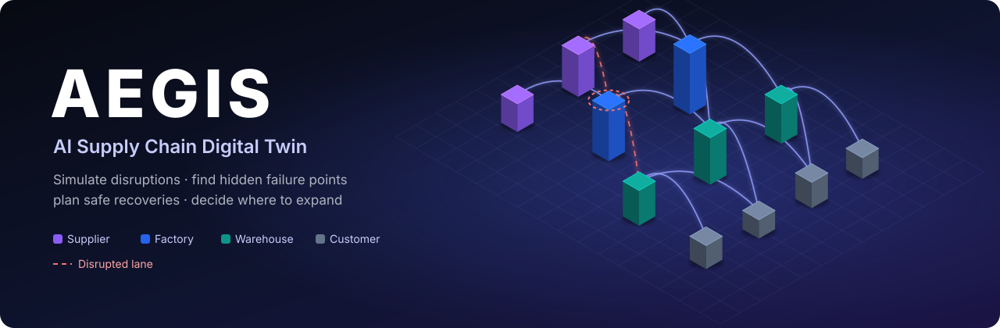
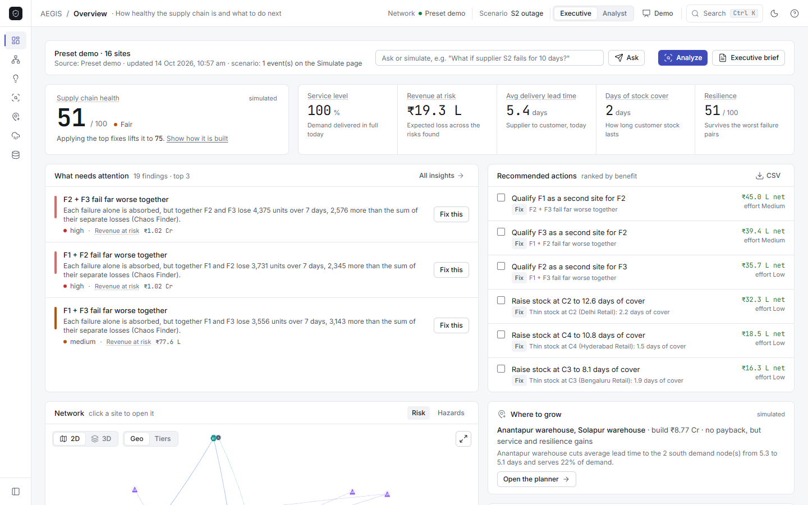
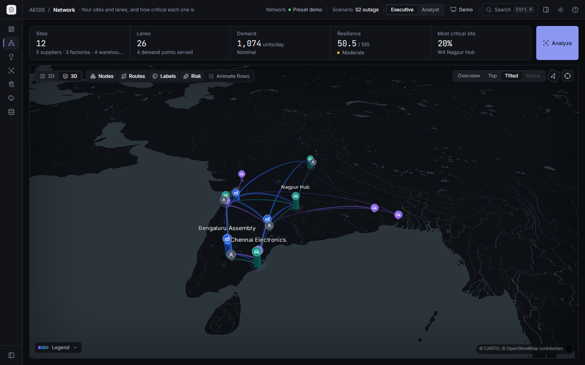
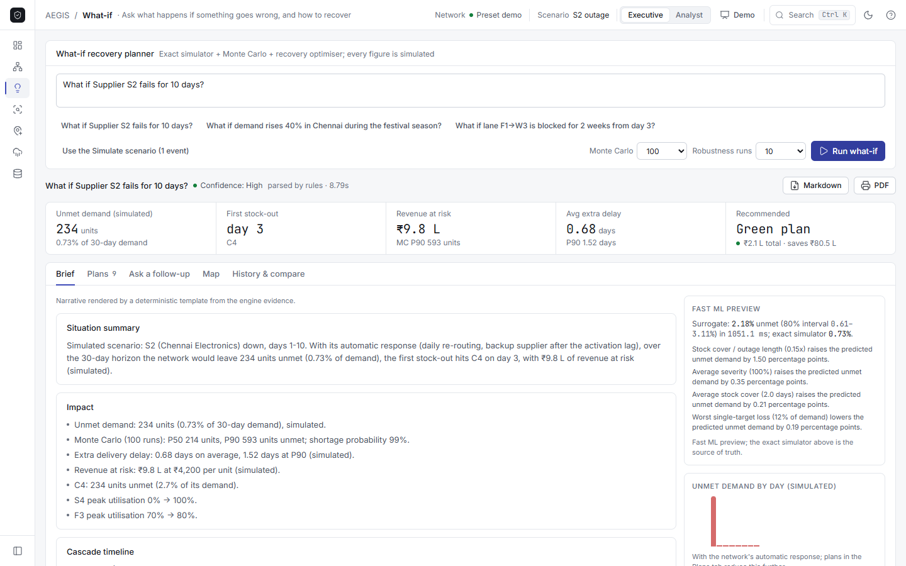
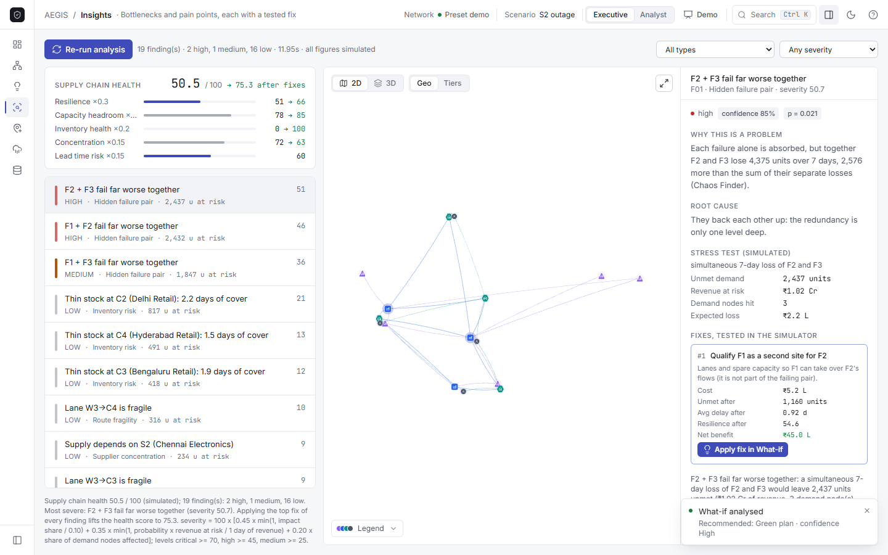
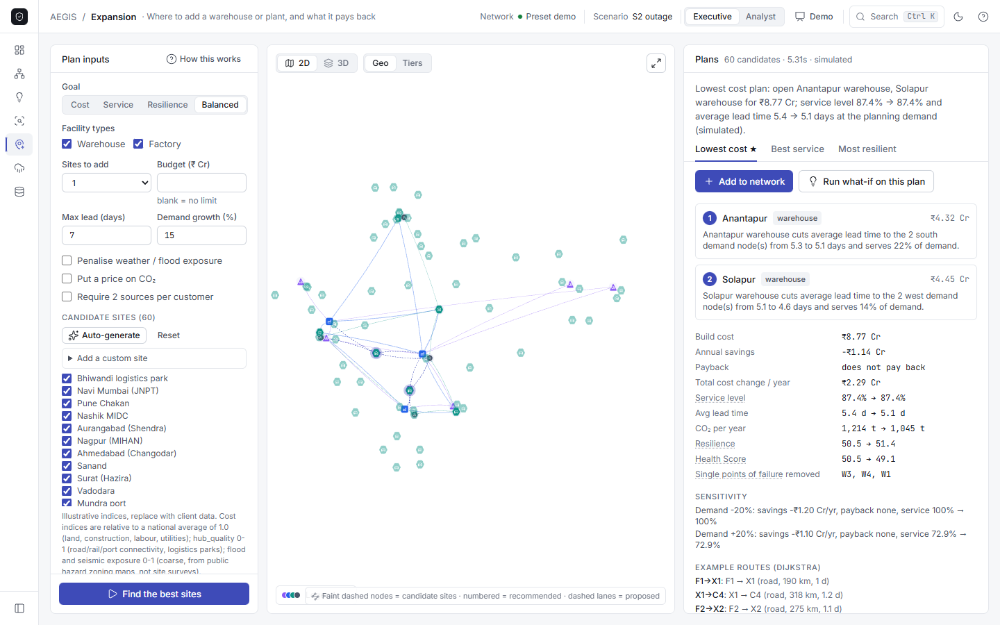
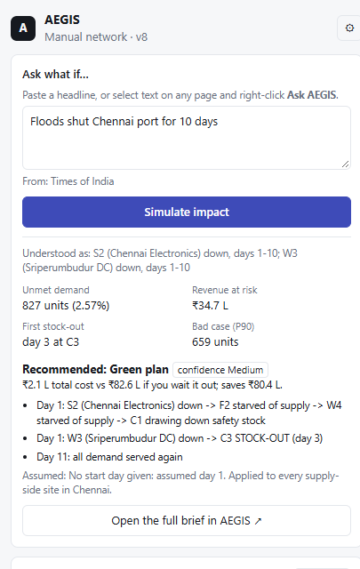
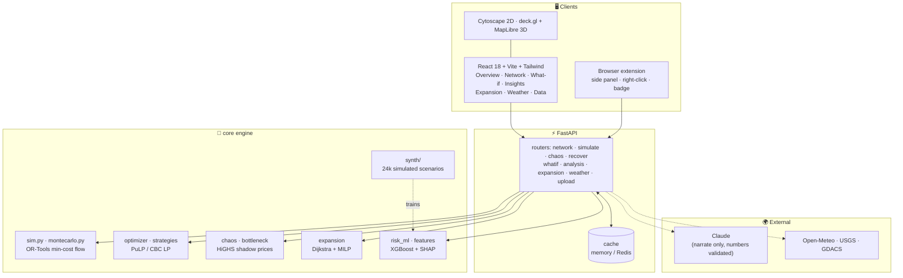

<div align="center">



### See the disruption coming. Find the failure nobody tested for. Pick a fix that doesn't break something else.

[](backend/requirements.txt)
[](backend/main.py)
[](frontend/package.json)
[](frontend/package.json)
[](frontend/src/components/map3d/Network3D.jsx)
[](backend/core/optimizer.py)
[](backend/core/risk_ml.py)
[-D97757)](backend/llm/parser.py)
[](backend/tests)

**[Quick start](#run-it)** · **[Feature tour](#feature-tour)** · **[Screenshots](#screenshots)** · **[Architecture](#architecture)** · **[API](#api-contract)** · **[Browser extension](#browser-extension)**

</div>

---

**AEGIS** is a digital twin of a multi-tier supply chain: **suppliers → factories → warehouses → customers** on a live
3D map of India. Throw a disruption at it (a plant fire, a flooded port, a festival demand spike) and watch the ripple
travel day by day. AEGIS then finds the weak spots on its own, recommends a recovery plan with the trade-offs laid
out, and tells you where a new warehouse or plant would pay off.

> Built for a real problem: [Supply bottlenecks: where, why, how much, and what next (IMF)](https://www.imf.org/en/publications/wp/issues/2022/02/15/supply-bottlenecks-where-why-how-much-and-what-next-513188).
> Every figure in the app is **simulated** by the AEGIS engine on your network data.

<table>
<tr>
<td width="33%" valign="top">

### 🧭 One-screen health
A **Health Score** (0-100) with a transparent breakdown, five plain-language KPIs, the three risks that matter and the
actions ranked by benefit. Made for a COO, not a data scientist.

</td>
<td width="33%" valign="top">

### 🧪 Ask "what if…?"
*"What if Supplier S2 fails for 10 days?"* gives you the impact, a day-by-day cascade, every recovery plan compared,
and **why** the best one wins, all grounded in engine evidence.

</td>
<td width="33%" valign="top">

### 🗺️ Where to grow
Dijkstra routing + a facility-location optimiser pick the best new warehouse or plant from **60 Indian cities**, and
the digital twin double-checks every plan.

</td>
</tr>
</table>

## Screenshots

<table>
<tr>
<td width="50%" valign="top"><br/><sub><b>Overview:</b> Health Score, KPIs, top risks and recommended actions</sub></td>
<td width="50%" valign="top"><br/><sub><b>3D twin:</b> sites as extruded columns, lanes as arcs, on a live map of India</sub></td>
</tr>
<tr>
<td width="50%" valign="top"><br/><sub><b>What-if planner:</b> impact, Monte Carlo, ML preview and a grounded brief</sub></td>
<td width="50%" valign="top"><br/><sub><b>Insights:</b> ranked pain points, each with a fix tested in the simulator</sub></td>
</tr>
<tr>
<td width="50%" valign="top"><br/><sub><b>Expansion:</b> candidate cities as ghosts, numbered picks, proposed lanes dashed</sub></td>
<td width="50%" align="center" valign="top"><br/><sub><b>Browser extension:</b> right-click a headline → simulated impact</sub></td>
</tr>
</table>

## Feature tour

| | Feature | What it does |
|:-:|---|---|
| 🧭 | **Overview** | Health Score with breakdown and trend, Service level, Revenue at risk, Lead time, Stock cover, Resilience; "Fix this" buttons; actions you can mark as planned; alerts; executive brief (2-page PDF) |
| 🌐 | **2D / 3D digital twin** | Cytoscape graph (geo or tier layout) and a deck.gl + MapLibre 3D map with camera presets, risk glow and animated flows |
| 💥 | **Simulator** | Day-by-day min-cost flow (OR-Tools) with stock buffers, backup activation lag, delays and a **Survival Clock** (days until stock runs out) |
| 🎲 | **Monte Carlo** | Replays a disruption 100× with realistic variation: typical loss (P50), bad case (P90), shortage probability |
| 🔍 | **Chaos Finder** | Knocks out every site and **every pair**; surfaces *hidden pairs* that are safe alone but deadly together; ML pre-screens 2,000 scenarios in < 1 s |
| 🛟 | **Recovery optimiser** | LP over reroute, backup supplier, overtime, safety stock, production shift and air expedite; **fix-safety check** rejects fixes that create a new weak spot |
| 🧪 | **What-if planner** | Plain English → scenario → impact, cascade timeline, every plan compared, counterfactual attribution, sensitivity, robustness and confidence; follow-up Q&A through 3 whitelisted engine tools |
| 🩺 | **Insights** | 8 detectors (capacity saturation with **LP shadow prices**, single points of failure, supplier concentration, inventory, lead time, route fragility, regional imbalance / bullwhip, hidden pairs), each with a stress test and re-simulated fixes |
| 🗺️ | **Expansion planner** | Dijkstra transport matrices → capacitated facility-location **MILP** (+ greedy cross-check) → resilience check on a copy of the network; payback, service, CO₂ and Health Score before / after |
| 🌧️ | **Weather & hazards** | Open-Meteo, flood, marine, USGS quakes and GDACS → lane risk → disruption events and weather-aware re-routing |
| 🤖 | **ML surrogate** | XGBoost trained on **24,000 simulated scenarios** over 400 synthetic networks; conformal 80% intervals; SHAP explanations in plain English |
| 🏭 | **Synthetic networks** | 7 network archetypes × 6 industries (FMCG, pharma cold-chain, electronics, automotive, apparel, agri); 3 ready-made demos |
| 🛡️ | **Grounded AI** | Claude may only re-word engine evidence; any number not in the evidence is rejected and a deterministic template is used |
| 🧩 | **Browser extension** | Right-click any news headline → **Ask AEGIS** → simulated impact in a side panel; alert badge on the toolbar |
| 🎬 | **Demo mode** | One click loads an FMCG story (network, analysis, what-if, expansion) and a 4-step guided tour |

<details>
<summary><b>Three things nobody else shows you</b></summary>

1. **Chaos Finder (reverse stress-test).** Don't wait for someone to ask "what if X fails?". AEGIS knocks out every
   node and **every pair** of nodes and ranks the damage. It surfaces *hidden pairs*: two warehouses that each look
   safe alone but together cut off a whole region (`synergy = unmet(a+b) − unmet(a) − unmet(b)`).
2. **Survival Clock.** One number a COO understands: *days until the first customer runs out of stock*. Below it:
   revenue at risk, and P50/P90 from a Monte Carlo over uncertain outage durations.
3. **Fix-safety check.** The cheapest fix is often a trap: draining safety stock fixes today and creates tomorrow's
   single point of failure. Every candidate strategy is re-stress-tested *after* it's applied; fixes that create a
   worse vulnerability get flagged red, and the recommendation is the cheapest **safe** plan.

</details>

## Architecture



<details>
<summary>Classic diagram (core flow)</summary>

```
  Browser :5173  React + Vite + Tailwind ──axios──► FastAPI :8000 ──► core/ (NetworkX graph, OR-Tools flow, PuLP LP,
                                                     │                 Chaos Finder, XGBoost + SHAP, Dijkstra + MILP)
                                                     ├──► cache (in-memory TTL, optional Redis :6379)
                                                     └──► llm/parser.py → Claude: parse text → events, narrate only
```

</details>

## Tech stack

**Frontend:** React 18 · Vite 8 · Tailwind CSS · Cytoscape.js · deck.gl 9 · MapLibre GL · Recharts · lucide-react ·
Axios  
**Backend:** Python 3.11+ · FastAPI · Pydantic v2 · NetworkX · OR-Tools · PuLP/CBC · SciPy (HiGHS) · NumPy · pandas ·
scikit-learn · XGBoost · SHAP · PyArrow · Redis (optional)  
**AI and data:** Anthropic Claude (grounded narration) · Open-Meteo · USGS · GDACS · CARTO basemaps  
**Ops:** Docker Compose · pytest (318 tests) · Chrome extension (Manifest V3)

---

## Run it

### Docker (everything)

```bash
cp .env.example .env          # optional: add ANTHROPIC_API_KEY
docker compose up --build
```

- UI: http://localhost:5173
- API + Swagger: http://localhost:8000/docs
- Redis: localhost:6379

### Local

```bash
# backend (Python 3.11+)
cd backend
python -m venv .venv
.venv/Scripts/activate        # Windows; on macOS/Linux: source .venv/bin/activate
pip install -r requirements.txt
pytest                        # smoke tests for every endpoint
uvicorn main:app --reload     # http://localhost:8000/docs

# frontend (Node 20+), in another terminal
cd frontend
npm install
npm test                      # node --test: node-type mapping + builder form validation
npm run dev                   # http://localhost:5173
```

The active network is saved to `backend/data/active_network.json` (override with `AEGIS_DATA_DIR`; Docker keeps it in
the `aegis-data` volume). Delete the file to start from the preset again; an unreadable file is moved aside to
`active_network.corrupt.json` and the app starts on the preset with a notice on the Data tab.

### Mock switches (one per router)

| Flag (default `true`) | Endpoints | When `false` |
|---|---|---|
| `USE_MOCK_NETWORK` | `GET /network`, `/forecast`, `/surrogate` | `core/risk_ml.py`, `core/chaos.py`, `core/forecast.py` |
| `USE_MOCK_SIMULATE` | `POST /simulate`, `/montecarlo` | `core/sim.py`, `core/montecarlo.py`, `core/delay.py` |
| `USE_MOCK_CHAOS` | `GET /chaos` | `core/chaos.py` |
| `USE_MOCK_RECOVER` | `POST /recover` | `core/strategies.py`, `core/optimizer.py`, `core/recommend.py` |
| `USE_MOCK_PARSE` | `POST /parse` | `llm/parser.py` (needs `ANTHROPIC_API_KEY`) |

A router switched to `false` calls `core/`. Unimplemented stubs raise `NotImplementedError`, which the API returns as
**HTTP 501** with a clear message, so each owner can go live independently. `GET /health` reports the current flags.
`POST /upload` is always live: CSV parsing and validation are real code.

**Mocks only describe the preset.** The flags apply while the preset demo is the active network. An activated CSV
network or a manual network always runs on the real engine (`core/`), whatever the flags say.

## Data tab: three ways to define the network

The Data tab has a **Preset demo | CSV upload | Manual builder** switch. All three produce the same thing, the *active
network*, which Twin, Simulate, Chaos Finder and Recover all use. The top bar shows the active source; click it to
jump to the Data tab.

| Source | How | Notes |
|---|---|---|
| Preset demo | "Use the preset demo" | The curated 16-site network behind the quick-start scenarios. "Copy into the builder" makes an editable copy. |
| CSV upload | `nodes.csv` + `edges.csv` ([templates](backend/mock/sample_nodes.csv)) with "Use it as the active network" checked | Unchecked = preview on the Twin tab only (the old behaviour). `kind` may now also be `retailer`. |
| Manual builder | Add nodes and lanes by hand, then **Apply network** | Saved on the server after every edit; undo/redo (last 20 actions); import/export JSON; export CSV in the upload format. |

**Builder workflow.** "Add node" opens a type picker (5 cards). The form adapts to the type, validates as you type
(Save stays disabled until it is valid) and has three ways to set a location: search ~45 Indian cities, type
latitude/longitude, or "Pick on map" and click the offline map preview (pure SVG: no tiles, works offline). "Add lane"
only offers legal targets for the chosen source and fills in distance (haversine), lead time, cost and CO₂ from the
coordinates and transport mode; every suggestion can be overridden. Click a row or a map marker to edit; deleting a
node asks for confirmation and lists the lanes that go with it. The validation panel is always visible: red errors
block Apply, amber warnings do not, and each item links to the node or lane it is about. Once the manual network is
active, every edit refreshes the other tabs automatically.

**Validation rules.** Errors (block Apply and every engine endpoint, which answers **409** with the reason): no active
supplier, no active retailer/customer, a lane pointing at a missing node, duplicate ids, duplicate lanes, self-loops.
Warnings: a node with no lanes, a demand point unreachable from any supplier, primary supplier capacity below total
demand, no backup supplier, an illegal tier direction (import only; the forms refuse them), zero total demand, a
warehouse holding more than its storage capacity, a lane ignored because one end is inactive. Field values are
checked by Pydantic (422 with the field name): negative numbers, latitude outside -90..90, longitude outside -180..180,
reliability outside 0..1, percentages outside 0..100, and fields that belong to another node type.

### Node types

The type of a node is always **shape + color + icon**. Its status (ok / stressed / down) is a ring, glow and badge in
the status colors (green `#22C55E`, amber `#F59E0B`, red `#EF4444`), never the fill. The definitions live in
[frontend/src/lib/nodeTypes.js](frontend/src/lib/nodeTypes.js), mirrored by [backend/node_types.py](backend/node_types.py).

| Type | Color | 2D shape | 3D column | Icon | Demand point |
|---|---|---|---|---|---|
| Supplier | violet `#8B5CF6` | triangle | tall thin triangular prism | truck | no |
| Factory | blue `#2563EB` | rounded square | wide square block with a stack on top (tallest) | factory | no |
| Warehouse | teal `#0D9488` | hexagon | wide, low hexagonal slab | warehouse | no |
| Retailer | magenta `#DB2777` | octagon | medium octagonal column | storefront | **yes** |
| Customer | slate `#475569` (light outline in dark mode) | circle | short round cylinder | person | **yes** |

Allowed lanes: supplier → factory, factory → warehouse, warehouse → retailer, warehouse → customer,
retailer → customer, plus the optional direct links supplier → warehouse, factory → retailer and factory → customer.

Retailers and customers are both **demand points**: the simulator, flow solver, Survival Clock, Chaos Finder, optimizer,
strategies, delay model, forecast and risk model treat them the same way (`is_demand()` in backend/node_types.py). A
retailer can also ship on to customers, limited by its forwarding capacity (0 = no limit). The pipeline runs on
networks that lack some tiers (for example supplier → warehouse → customer with no factory).

The 2D view (Cytoscape) offers a **Geo** layout (latitude/longitude) and a **Tiers** layout (one column per tier).
The 3D view (deck.gl) uses lit columns whose height follows stock, a billboard icon and a name label (it fades in as you
zoom), a status ring that pulses when a node is down, a ripple when a node newly fails, a criticality glow, lanes
colored by their source type, dashed red disrupted lanes, accent recovery routes, and flow particles whose speed
follows lead time and whose color shows the transport mode. Both views share one legend: click a type to hide it.
3D loads lazily, needs WebGL, and falls back to 2D on any error.

### Node field reference

Common to every type: `id` (auto-generated as S1, F1, W1, R1, C1 ..., editable only on create; letters, digits, `-`,
`_`), `name`, `kind`, `city` (address or city), `lat`, `lon`, `capacity` (units/day), `stock` (units), `reliability`
(0..1), `op_cost` (₹/unit), `status` (`active` | `inactive`; inactive nodes and their lanes are left out of every run).

| Type | Extra fields | Engine mapping |
|---|---|---|
| Supplier | `material`, `lead_time_days`, `min_order_qty`, `is_backup`, `price_per_unit` | `backup = is_backup` (a backup opens only after a shortfall, at 1.5x lane cost) |
| Factory | `production_capacity` (units/day), `production_cost`, `overtime_limit_pct`, `shifts_per_day` | `capacity = production_capacity` when given |
| Warehouse | `storage_capacity`, `safety_stock`, `holding_cost` (₹/unit/day), `handling_time_days` | `capacity` = throughput/day |
| Retailer | `daily_demand` (required), `demand_variability_pct`, `service_level_pct`, `shelf_stock` | `demand = daily_demand`, `stock = stock + shelf_stock`, `capacity` = forwarding limit |
| Customer | `daily_demand` (required), `priority` (low/medium/high), `penalty_per_unit` | `demand = daily_demand` |

Lanes: `source`, `target`, `mode` (road/rail/sea/air), `distance_km`, `lead` (days), `capacity` (units/day), `cost`
(₹/unit), `co2` (kg/unit), `status`. Empty distance/lead/cost/co2 are suggested: distance by haversine, lead =
distance / speed + handling (road 450 km/day + 0.5 d, rail 380 + 1, sea 350 + 2, air 4000 + 0.5; at least 1 day), CO₂
per unit-km (road 0.0026, rail 0.0011, sea 0.0008, air 0.012 kg). Extra fields are kept and shown in the node drawer.

## API contract

| Method | Path | Body | Response |
|---|---|---|---|
| GET | `/network` | - | `{ nodes:[{id,kind,city,lat,lon,capacity,stock,demand,risk,reliability,utilization,top_factors:[{feature,impact}]}], edges:[{source,target,capacity,lead,cost,co2}], resilience_score }` |
| POST | `/simulate` | `{ events:[Event], horizon=30 }` | `{ timeline:[{day,unmet,down:[id],node_status:{id:"ok\|stressed\|down"},utilization:{id:float}}], log:[str], stockout_day:{customerId:day}, total_unmet, survival_clock_days, revenue_at_risk, delay:{avg_days,p90_days,per_customer:{id:days}}, bottlenecks:[{node,utilization,day}] }` |
| POST | `/montecarlo` | `{ events:[Event], n=200 }` | `{ p50, p90, p_shortage, histogram:[{bin,count}] }` |
| GET | `/chaos` | `?top=5` | `{ spof:[{target,unmet}], hidden_pairs:[{pair:[a,b],unmet,synergy}], resilience_score }` |
| POST | `/recover` | `{ events:[Event] }` | `{ strategies:[{name,cost,unmet,recovery_days,delay_avg_days,co2,resilience_after,safety_check:{passed,warning},recommended}], roi:{inaction_loss,fix_cost,net_saving}, playbook:[str], alternate_suppliers:[{replaces,supplier,name,city,spare_capacity,lead,cost_premium_pct,reliability}], alternate_routes:[{origin,destination,via,replaces,spare_capacity,extra_lead_days,extra_cost_per_unit}], inventory_actions:[{node,action,units,source,day,reason}], production_actions:[{from_factory,to_factory,units_per_day,start_day,duration,reason}] }` |
| POST | `/parse` | `{ text }` | `{ events:[Event] }` |
| GET | `/forecast` | `?horizon=14` | `{ horizon_days, method, mape, customers:[{id, history:[{day,demand}], forecast:[{day,mean,p10,p90}]}] }` |
| GET | `/surrogate` | - | `{ target, mae, r2, n_train, n_test, speedup, top_features:[{feature,importance}], scenario:{...models/metrics.json} }` |
| GET | `/chaos/prescreen` | `?n=2000&top=15` | surrogate-ranked failure scenarios re-run on the exact simulator: `{ candidates, control, agreement:{spearman,precision_at_k,...}, timing:{speedup,...} }` |
| POST | `/whatif/run` | `{ text }` or `{ events:[Event] }`, `horizon, mc_runs, robustness_runs` | `{ id, sections:[{key,title,paragraphs,bullets,evidence}], evidence, plans, recommended, confidence, narrative_source, brief_markdown }` |
| POST | `/whatif/ask` | `{ run_id, question }` | `{ declined, tool:{name,args}, evidence, answer:[str] }` (tools: `run_scenario`, `run_strategy`, `compare_plans`) |
| GET | `/whatif/history` | - | `{ runs:[summary], limit }`; `GET /whatif/{id}`, `GET /whatif/{id}/brief` (Markdown) |
| POST | `/whatif/compare` | `{ ids:[2..4] }` | `{ runs, metrics:[{key,label,values}] }` |
| POST | `/analysis/run` | `?wait=false&force=false` | `{ status:"running", progress }` or the result: `{ findings:[...], health:{score,breakdown,after_fixes}, severity_formula, sections }` |
| GET | `/analysis/latest` | - | latest result for the current network version, `{status:"running"\|"none"}` otherwise |
| GET | `/analysis/finding/{id}` | - | one finding: `{ id, title, type, locations, severity, confidence, evidence, why, root_cause, business, stress, fixes:[{label,cost,result}] }` |
| GET / POST | `/expansion/candidates` | POST `{action: add\|remove\|exclude\|include\|auto\|reset, ...}` | `{ note, sites:[{id,name,lat,lon,region,cost indices,hub_quality,flood_exposure,seismic_exposure,source,excluded}] }` |
| GET | `/expansion/baseline` | - | today's KPIs from the flow engine: `{ service_level_pct, avg_lead_days, stock_cover_days, freight_inr_per_day, co2_t_per_year, ... }` |
| POST | `/expansion/run` | `{ goal, types, n_add, budget, max_lead_days, weather, co2, growth, redundancy, max_per_type, candidate_ids }`, `?wait=false` | `{ id, status:"running", progress }`; poll `GET /expansion/results/{id}`, cancel `POST /expansion/results/{id}/cancel`, latest `GET /expansion/latest` |
| GET | `/expansion/results/{id}` | - | `{ plans:[{label, sites:[{name,kind,rationale,example_paths}], build_cost, annual_savings, payback_years, service/lead/CO2/resilience/health before and after, spof_removed, sensitivity}], cross_check, marginal_values, recommendation_stability }` |
| POST | `/expansion/apply` | `{ plan_id }` | adds the plan's sites and lanes through the Manual Builder (one undoable import), bumps the network version |
| POST | `/upload` | multipart `nodes`, `edges` (CSV), `?activate=false` | `{ network:{...as /network, resilience_score:null}, summary:{n_nodes,n_edges,by_kind}, warnings:[str], activated }` |
| GET | `/health` | - | `{ status, mock:{network,simulate,chaos,recover,parse}, network:{source,version} }` |

**Demo and synthetic networks:** `GET /network/demos` (3 ready-made demos + generator options), `GET /network/demos/{id}`
and `POST /network/generate {archetype, industry, n_nodes, seed?}` return builder JSON that the UI loads through
`POST /network/import?activate=true`, so they become ordinary, editable manual networks.

**Network builder** ([backend/routers/network_builder.py](backend/routers/network_builder.py)). Every change bumps the
network `version`, rebuilds the graph, clears every graph-dependent cache (API responses incl. Redis keys, chaos scans,
Monte Carlo, forecasts) and saves to disk, under a lock. Mutations return the new `version` and the manual network's
`validation`.

| Method | Path | Body / query | Response |
|---|---|---|---|
| GET | `/network/source` | - | `{ source:"preset"\|"csv"\|"manual", version, node_count, edge_count, runnable, manual_node_count, manual_edge_count, csv_loaded, note }` |
| PUT | `/network/source` | `{ source }` | same as GET; 409 if `manual` has errors or no CSV was uploaded |
| GET | `/network/manual` | - | `{ source, version, nodes:[BuilderNode], edges:[BuilderEdge], validation }` |
| POST / PUT / DELETE | `/network/nodes`, `/network/nodes/{id}` | `BuilderNode` | `{ node, removed_edges, version, validation }` (DELETE also removes the node's lanes and lists them) |
| POST / PUT / DELETE | `/network/edges`, `/network/edges/{id}` | `BuilderEdge` | `{ edge, version, validation }` |
| POST | `/network/validate` | optional `{ nodes, edges }` draft | `{ errors:[{code,message,refs}], warnings:[...], runnable }` |
| POST | `/network/reset` | `?to=preset\|empty` | manual network; `preset` copies the preset into the builder and activates the preset |
| GET | `/network/export` | `?scope=manual\|active\|preset` | `{ format:"aegis-network", schema_version, source, version, nodes, edges }` |
| GET | `/network/export/csv` | `?file=nodes\|edges&scope=manual\|active` | `text/csv` in the `/upload` format |
| POST | `/network/import` | export JSON, `?activate=false` | manual network; 422 (nothing changes) on duplicate ids, unknown endpoints, self-loops, duplicate lanes |

`Node.risk` is `null` (with `risk_note`) when the network is too small or the model cannot score it; `Node.details`
carries the builder's extra fields; `Edge` may carry `id`, `mode`, `distance_km`. Demand events may target a retailer or
a customer. Engine endpoints answer **409** with a readable reason while the active CSV/manual network is not runnable
(for example when it is empty). Unexpected errors come back as JSON (`{"detail": "Internal error ..."}`), never a
stack trace.

CSV templates: [backend/mock/sample_nodes.csv](backend/mock/sample_nodes.csv) and
[backend/mock/sample_edges.csv](backend/mock/sample_edges.csv). The UI also serves them under `/samples/`. Bottleneck =
utilization above 90%.

`Event = { type: "node"|"edge"|"demand", target: nodeId | "SRC->DST", start: day≥0, duration: days≥1, severity: 0..1 }`

Errors: `422` invalid body or unknown node/edge id, `501` core function not implemented yet, `503` LLM unavailable.
All schemas live in [backend/schemas.py](backend/schemas.py).

## Browser extension

[chrome-extension/](chrome-extension/README.md) (Chrome / Edge, load unpacked): select a news headline on any page,
right-click **Ask AEGIS** and the side panel simulates its impact on your network; the panel also shows the Health
Score, KPIs and top risks, and the toolbar badge counts urgent alerts.

## Expansion planner and executive dashboard

**Expansion planner** (Expansion tab, [backend/core/expansion.py](backend/core/expansion.py)). Dijkstra alone finds the
cheapest *path*; it does not choose *locations*, so the planner works in stages:
1. **Dijkstra stage:** a transport graph over the existing sites plus ~60 candidate cities
   ([backend/data/candidate_sites.json](backend/data/candidate_sites.json), illustrative indices: replace with client
   data), each linked to its 6 nearest neighbours by the best of road / rail / sea / air (freight + time value, optional
   CO2 price and flood-exposure penalty). Dijkstra from every candidate gives cost, lead-time and CO2 matrices to every
   customer and from every supplier and plant; cached until the network changes.
2. **Location optimization:** a capacitated fixed-charge facility-location MILP (PuLP/CBC) picks which candidates to
   open and which customers they serve, minimising annualised capex + opex + freight + holding + lost margin (+ CO2),
   within budget, sites per type, a lead-time radius and optional "two sources per customer". The extra flow is bounded
   by the upstream headroom the flow engine can actually deliver. A greedy marginal-gain heuristic cross-checks it;
   infeasible inputs get a plain explanation.
3. **Resilience evaluation:** each plan (Lowest cost, Best service, Most resilient) is added to a *copy* of the network;
   the simulator, Chaos Finder and the Health Score are re-run, and savings, payback and demand +-20% sensitivity come
   from those runs. "Add to network" applies a plan through the Manual Builder as one undoable step.

**Executive dashboard.** The app opens on **Overview**: Health Score (with breakdown and trend), five KPIs with
one-line meanings, the three findings that need attention ("Fix this" opens a prefilled what-if), recommended actions
ranked by benefit (mark them as planned), a compact map with risk and hazard layers, the best expansion site,
alerts and recent scenarios. **Executive / Analyst** toggle: Analyst adds evidence expanders and the analyst tools
(Simulate, Chaos Finder, Recover). **Demo** loads an FMCG story (network, analysis, what-if, expansion) with a
four-step tour. **Executive brief** prints a two-page A4 summary (save as PDF); tables export to CSV. Every metric has
one definition, shown in its tooltip ([frontend/src/lib/glossary.js](frontend/src/lib/glossary.js)).

## Synthetic data, ML surrogate, what-if planner and insights

* **Synthetic generator** ([backend/core/synth/](backend/core/synth/), assumptions in
  [backend/data/synth_assumptions.md](backend/data/synth_assumptions.md)): 7 archetypes x 6 industry profiles, 10-60
  nodes in real Indian cities, mode-based lead times, 55-85% baseline utilisation, seasonality, bullwhip, and a
  13-type disruption library (incl. weather-driven closures from the hazard impact table and correlated compound
  events). Build the dataset with `python -m core.synth.build --n-networks 400 --cases-per-network 60 --seed 42`
  (24,000 exact simulations, about 1.5 minutes on 12 cores; `--fast` for tests). Data card:
  [backend/data/synth/DATA_CARD.md](backend/data/synth/DATA_CARD.md).
* **Features** in one place: [backend/core/features.py](backend/core/features.py).
* **Scenario surrogate** ([backend/core/risk_ml.py](backend/core/risk_ml.py), `python -m core.risk_ml --scenario`):
  XGBoost per target (unmet %, avg delay, stock-out day, recovery days), randomized search + early stopping, monotonic
  constraints, conformalized 80% intervals, compared against a mean predictor and a centrality heuristic on networks it
  never saw; metrics in `backend/models/metrics.json` and `GET /surrogate`. It pre-screens Chaos Finder scenarios and
  previews what-ifs; **every number displayed comes from the exact simulator.**
  > **Note:** the labels come from our simulator, so the model is a fast surrogate validated on held-out synthetic
  > networks, not a model of real-world outcomes.
* **What-if planner** (What-if tab, [backend/core/whatif.py](backend/core/whatif.py)): plain English or the Simulate
  scenario -> exact baseline vs scenario, Monte Carlo, cascade timeline, every recovery plan with fix-safety check and
  Pareto flag, counterfactual attribution, sensitivity and robustness, follow-up questions through a whitelist of
  engine tools, history/compare, Markdown/PDF brief.
* **Insights** (Analyze on the Twin tab, [backend/core/bottleneck.py](backend/core/bottleneck.py)): capacity
  saturation with LP shadow prices, single points of failure, supplier concentration, inventory risk, lead-time chain,
  route fragility, regional imbalance / bullwhip and hidden failure pairs; each finding has a stress test and fixes that
  are re-simulated, plus a 0-100 health score before and after fixes.
* **Grounded reasoning** ([backend/core/narrative.py](backend/core/narrative.py)): explanations are rendered from an
  evidence object; an LLM may only re-word them and is rejected if it writes a number that is not in the evidence
  (without an API key the deterministic template is used). Every section has an Evidence expander.

## PS 04 requirements → features

> This mapping uses the PS 04 requirements as we read them from the brief. Check it against the official problem
> statement before submitting and adjust the left column's wording to match.

| Requirement | Delivered by | Where | Status today |
|---|---|---|---|
| Digital twin of a multi-tier supply network | 16-node, 4-tier network on a map, with capacity, stock, reliability and utilization per node | Twin tab, `GET /network`, `core/graph.py` | **Real** (mock layer optional via `USE_MOCK_*`) |
| Ingest a company's own network data | CSV upload with validation and warnings, preview or activate; manual network builder with validation, undo/redo, JSON/CSV export | Data tab, `POST /upload`, `/network/*` | **Real** (mock layer optional via `USE_MOCK_*`) |
| Simulate disruptions (supplier, route, demand) | Event builder (node / edge / demand, start, duration, severity), 3 one-click demos, plain-English input | Simulate tab, `POST /simulate`, `POST /parse` | **Real** (mock layer optional via `USE_MOCK_*`) |
| Show how disruption propagates over time | Day slider recolours nodes ok/stressed/down; event log; ripple timeline | Simulate tab | **Real** (mock layer optional via `USE_MOCK_*`) |
| Estimate delivery delays | Avg / P90 delay KPI, per-customer delay chart | Simulate → KPIs, *Delivery delay by customer* | **Real** (mock layer optional via `USE_MOCK_*`) |
| Identify bottlenecks | Per-day utilization bars, bottleneck halo on the graph, peak-bottleneck list (>90%) | Simulate → *Utilization*, graph | **Real** (mock layer optional via `USE_MOCK_*`) |
| Quantify business impact | Unmet units, Survival Clock, revenue at risk, Monte Carlo P50/P90 | Simulate → KPIs, Monte Carlo chart | **Real** (mock layer optional via `USE_MOCK_*`) |
| Predict risk with explainable ML | Node risk score + SHAP factors on click; simulator surrogate with MAE / R² | Twin → node panel, *ML surrogate accuracy*, `GET /surrogate` | **Real** (mock layer optional via `USE_MOCK_*`) |
| Forecast demand | 14-day forecast with P10-P90 band and backtest MAPE | Twin → *Demand forecast*, `GET /forecast` | **Real** (mock layer optional via `USE_MOCK_*`) |
| Find vulnerabilities proactively | Chaos Finder: single points of failure and hidden failure pairs, resilience score | Chaos Finder tab, `GET /chaos` | **Real** (mock layer optional via `USE_MOCK_*`) |
| Recommend alternate suppliers and routes | Ranked alternate suppliers (spare capacity, lead, premium, reliability), alternate paths | Recover → *Alternate suppliers / routes* | **Real** (mock layer optional via `USE_MOCK_*`) |
| Optimize inventory and production | Inventory buffer and production shift strategies, concrete inventory and production actions | Recover → strategy table, *Inventory / Production actions* | **Real** (mock layer optional via `USE_MOCK_*`) |
| Compare mitigation strategies | Cost vs unmet vs delay vs CO₂ vs resilience, ROI of acting, fix-safety check | Recover tab, `POST /recover` | **Real** (mock layer optional via `USE_MOCK_*`) |
| Actionable output for operators | Day-by-day playbook (LLM narration is guarded against invented numbers) | Recover → *Action playbook* | **Real** (mock layer optional via `USE_MOCK_*`) |
| Plan recovery for a stated scenario | What-if planner: impact, cascade, every plan compared, attribution, sensitivity, confidence, follow-up Q&A | What-if tab, `/whatif/*` | **Real** |
| Find bottlenecks and pain points | 8 detectors with stress tests and re-simulated fixes, LP shadow prices, Health Score | Insights tab, `/analysis/*` | **Real** |
| Decide where to expand | Dijkstra + facility-location MILP + resilience check on a network copy | Expansion tab, `/expansion/*` | **Real** |
| Executive reporting | Overview dashboard, executive brief (PDF), CSV exports, demo mode | Overview tab | **Real** |

## Limitations (honest)

- **Synthetic data.** The network, risk factors, demand history and every number in the UI are synthetic and shaped
  to look realistic for Indian logistics. Nothing is calibrated against real suppliers, so treat every output as
  illustrative until it runs on real data.
- **Mock layer is optional.** Every engine described here is implemented and tested (318 tests). The `USE_MOCK_*`
  switches (default `true` for the preset) serve scripted demo payloads on the older Simulate / Chaos Finder /
  Recover endpoints; set them to `false` to run the real engine everywhere. What-if, Insights, Expansion and Weather
  always use the real engine.
- **Prototype scale.** Networks of up to 60 nodes and 400 lanes in the builder, a single product, a 30-day horizon at
  daily resolution. Lead times enter as delay, not shipping lag; no BOMs or multi-echelon inventory policies.
- **In-process state.** The active network is saved to disk; what-if history, analysis and expansion results live in
  memory and reset when the backend restarts. There are no user accounts.
- **Surrogate scope.** The ML model is trained on simulator labels, so it is a fast surrogate validated on held-out
  synthetic networks, not a model of real-world outcomes. Expansion site costs use illustrative indices.
- **Scaling path, not built yet:** Neo4j for graph storage and path queries on 10k+ node networks; Redis (already
  wired as an optional cache) for shared result caching and as a job queue for Monte Carlo and Chaos Finder batches
  (the ML surrogate pre-screen, `GET /chaos/prescreen`, is built); PostgreSQL for
  scenario and run history. Postgres and Neo4j are commented out in `docker-compose.yml`.
- **LLM scope.** Claude only parses scenarios, routes follow-up questions to 3 whitelisted engine tools and re-words
  engine evidence. Parsed events are validated against the graph, and any narration containing a number the engine
  didn't produce is rejected in favour of a deterministic template.

## Who owns what

| Owner | Area | Files |
|---|---|---|
| **A** | Simulation engine | `core/graph.py`, `core/sim.py`, `core/montecarlo.py`, `core/delay.py` |
| **B** | Optimizer + Chaos Finder | `core/optimizer.py`, `core/chaos.py`, `core/strategies.py`, `core/recommend.py` |
| **C** | Frontend | `frontend/src/**` |
| **D** | ML + LLM + integration | `core/risk_ml.py`, `core/forecast.py`, `llm/parser.py`, `routers/` (incl. upload), `docker-compose.yml`, tests |

Contract rule: nobody changes `schemas.py` without telling C and D. Mock and live outputs must validate against the same models.

## Build phases / TODO

**Phase 0: Scaffold (done)**
- [x] API contract + Pydantic schemas, mock data for every endpoint
- [x] UI wired to mocks: graph, day slider, KPIs, Monte Carlo, Chaos Finder, Recover, Playbook
- [x] Docker compose, Redis cache hook, pytest smoke tests

**Phase 0.5: Upgrade (done)**
- [x] Per-router `USE_MOCK_*` flags
- [x] Reliability/utilization, delay, bottlenecks, alternates, inventory/production actions in schemas + mocks + UI
- [x] `/forecast`, `/surrogate`, `/upload` (CSV upload is real), tests for all new endpoints

**Phase 1: Simulation core (A)**
- [x] `sim.solve_flow`: min-cost flow with node splitting (NetworkX / OR-Tools)
- [x] `sim.simulate`: day loop, stock drawdown, node status, per-day utilization, Survival Clock
- [x] `delay.customer_delays`: lead-time-aware delay model (SimPy)
- [x] `montecarlo.monte_carlo`: lognormal durations, P50/P90
- [x] Set `USE_MOCK_SIMULATE=false` and keep the tests green

**Phase 2: Chaos + recovery (B)**
- [x] `chaos.chaos_find`: singles + pruned pair-synergy search
- [x] `chaos.resilience_score`
- [x] `optimizer.optimize_plan` with the `safety_stock_lever` and `production_shift_lever` levers (PuLP)
- [x] `recommend.alternate_suppliers` / `alternate_routes`
- [x] `strategies.run_strategies` + `safety_check` (re-run Chaos Finder on the post-fix graph)

**Phase 3: Intelligence (D)**
- [x] `risk_ml.train_risk_model` (XGBoost on synthetic disruption history) + `node_risk_with_shap`
- [x] `risk_ml.train_surrogate` + `surrogate_report` (MAE / R² on held-out scenarios)
- [x] `forecast.forecast_demand`: Holt-Winters vs XGBoost lag model, backtest MAPE
- [x] Live `/parse` with `ANTHROPIC_API_KEY`; add eval prompts for tricky phrasing
- [x] `write_playbook` wired into `/recover` with the number-grounding guard

**Phase 4: Polish and demo (C + all)**
- [x] Edge disruptions drawn on the graph (dashed red lanes)
- [x] Before/after resilience comparison on the Recover tab
- [x] 3-minute demo script: Twin → Supplier failure → Chaos Finder hidden pair → Recover (cheapest fix fails safety check)

**Phase 5: Intelligence upgrade (done)**
- [x] Synthetic data generator (7 archetypes x 6 industries) + 24,000-scenario dataset + data card
- [x] Scenario surrogate (XGBoost, conformal intervals, SHAP) beating mean and centrality baselines on held-out networks
- [x] What-if recovery planner with grounded narration; Insights analyzer with tested fixes and Health Score

**Phase 6: Expansion and executive experience (done)**
- [x] Expansion planner (Dijkstra + facility-location MILP + resilience evaluation), apply as one undoable step
- [x] Overview dashboard, Executive / Analyst views, demo mode with tour, executive brief, Weather page
- [x] Browser extension (side panel, right-click "Ask AEGIS", alert badge)
